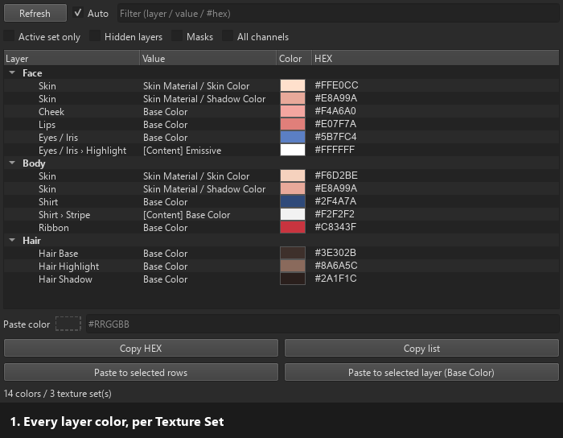

# gyogy6 Layer Color Viewer (무료판)

[English](README.md) / [日本語](README.ja.md) / [简体中文](README.zh-CN.md) / **한국어**

*패널 동작 (샘플 데이터): 색 목록 → 얼굴 피부색 복사 → 몸에 붙여 넣기 → HEX로 걸러내기.*

Substance 3D Painter용 Python 플러그인입니다.
레이어에서 사용하는 색을 텍스처 세트(Texture Set)별로 목록으로 확인할 수 있습니다.
목록의 색은 더블클릭으로 복사하고, 다른 레이어에 붙여 넣을 수 있습니다.

- 버전: 1.0.0
- 가격: 무료 (상업적 이용 가능, 크레디트 선택 사항)
- 이용약관: [LICENSE.md](LICENSE.md) (**다운로드하거나 사용한 시점에 이 약관에 동의한 것으로 간주합니다**)

| 기능 | 내용 |
|---|---|
| **색 목록** | 표시 중인 레이어에 대해 레이어 이름, 어떤 값인지, 색 견본, HEX(#RRGGBB)를 목록으로 보여 줍니다. |
| **복사** | 행을 더블클릭하면 HEX를 복사합니다. 오른쪽 클릭으로 RGB(0–255)나 소수(0–1)로도 복사할 수 있습니다. |
| **붙여 넣기** | 복사한 색을 목록의 다른 행이나, 레이어 패널에서 선택한 Fill 레이어의 Base Color에 씁니다. |

Fill 레이어의 색 외에도 .sbsar 머티리얼, 제너레이터, 필터의 색 파라미터도 목록에 나옵니다.

---

## 1. 포함된 파일

| 파일 | 내용 |
|---|---|
| `gyogy6_layer_color_viewer/` | 플러그인 본체 (폴더째로 사용합니다) |
| `docs/demo.gif` | 이 설명서의 데모 애니메이션 |
| `README.ko.md` 등 | 이 설명서 (영어, 일본어, 중국어, 한국어) |
| `LICENSE.md` | 이용약관 |

## 2. 동작 환경

- Adobe Substance 3D Painter 10 이상 (Python 플러그인이 PySide6로 동작하는 버전)
- Painter 11.1.3에서 동작을 확인했습니다

패널의 툴팁과 메시지는 Painter가 일본어로 실행 중이면 일본어로, 그 외에는 영어로 표시됩니다.

## 3. 설치

1. Substance 3D Painter를 실행합니다.
2. 상단 메뉴에서 **Python → Plugins Folder**를 선택하면 플러그인 폴더가 열립니다.
   (보통 `Documents/Adobe/Adobe Substance 3D Painter/python`입니다.)
3. 그 안의 `plugins` 폴더에 `gyogy6_layer_color_viewer` 폴더를 **폴더째로** 복사합니다.
4. **Python → Reload Plugins Folder**를 선택하거나 Painter를 다시 시작합니다.

## 4. 사용 방법

### 4-1. 패널 표시

1. **Python** 메뉴를 열고 **gyogy6_layer_color_viewer**에 체크합니다.
2. **gyogy6 Layer Colors** 패널이 표시됩니다.
   찾을 수 없으면 **Window → Views**에서 찾아 주십시오.

### 4-2. 색 목록 보기

프로젝트를 열면 자동으로 목록이 표시되며, 텍스처 세트별로 묶여 있습니다.

| 열 | 내용 |
|---|---|
| **Layer** | 레이어 이름입니다. 그룹 안에 있으면 `그룹 이름 / 레이어 이름`, 이펙트는 `레이어 이름 › 이펙트 이름`으로 표시됩니다. |
| **Value** | 어떤 값의 색인지 나타냅니다 (아래 표). |
| **Color** | 색 견본입니다. |
| **HEX** | `#RRGGBB` 형식의 색 코드입니다. |

**Value 열에 표시되는 것**

| 표시 | 의미 |
|---|---|
| `Base Color`, `Emissive` 등 | Fill 레이어의 채널 색 (단색일 때) |
| `머티리얼 이름 / 파라미터 이름` | Fill 레이어에 넣은 .sbsar 머티리얼의 색 파라미터 |
| `Base Color: 제너레이터 이름 / 파라미터 이름` | 채널별로 넣은 .sbsar의 색 파라미터 |
| `[Content] …` | 레이어 안에 추가한 Fill 이펙트, 제너레이터, 필터의 색 |
| `[Mask] …` | 마스크 안 이펙트의 색 (**Masks**에 체크했을 때만) |
| `Text Color` 등 | 텍스트(폰트) 레이어의 글자 색과 배경 색 |

**패널 위쪽의 옵션**

| 항목 | 동작 |
|---|---|
| **Refresh** | 목록을 다시 읽습니다. |
| **Auto** | 레이어가 바뀔 때마다 자동으로 목록을 다시 읽습니다 (기본값은 켜짐). |
| **Filter** | 입력한 문자를 포함하는 행만 표시합니다. 레이어 이름, 값 이름, `#FFE3` 같은 HEX 일부로 걸러낼 수 있습니다. |
| **Active set only** | 레이어 패널에서 선택한 텍스처 세트만 표시합니다. |
| **Hidden layers** | 숨긴 레이어도 표시합니다. 기본적으로 눈 아이콘이 꺼진 레이어(와 숨긴 그룹의 내용)는 목록에 나오지 않습니다. |
| **Masks** | 마스크 안 이펙트의 색도 표시합니다. |
| **All channels** | Roughness 등 색 이외의 채널 값(회색)도 표시합니다. |

### 4-3. 색 복사

- **행을 더블클릭**(Value, Color, HEX 열)하면 HEX를 클립보드에 복사합니다.
- 행을 선택하고 **Copy HEX**를 눌러도 같습니다. 여러 행을 선택하면 HEX를 한 줄씩 복사합니다.
- 행을 **오른쪽 클릭**하면 다음 형식으로도 복사할 수 있습니다.

  | 메뉴 | 복사되는 문자 |
  |---|---|
  | Copy HEX | `#FFE3D1` |
  | Copy RGB | `255, 227, 209` |
  | Copy float | `1.0000, 0.8902, 0.8196` |

- **Copy list**를 누르면 표시 중인 목록을 탭으로 구분된 텍스트로 복사합니다. 스프레드시트에 그대로 붙여 넣을 수 있습니다.

> **팁:** **Layer** 열을 더블클릭하면 Painter의 레이어 패널에서 그 레이어를 선택합니다. 오른쪽 클릭 메뉴의 **Select layer in Layers panel**도 같습니다.

### 4-4. 색 붙여 넣기

복사한 색은 패널 아래의 **Paste color** 칸에 들어갑니다. 이 칸에 직접 입력해도 됩니다.
입력할 수 있는 형식: `#RRGGBB`, `#RGB`, `rgb(255, 128, 0)`, `255, 128, 0`, `1.0, 0.5, 0.0`.
(0–1 소수로 입력할 때는 `1.0`처럼 소수점을 붙여 주십시오. 소수점이 없으면 0–255로 읽습니다.)

| 버튼 | 동작 |
|---|---|
| **Paste to selected rows** | 목록에서 선택한 행(여러 개 가능)에 색을 씁니다. 오른쪽 클릭 메뉴의 **Paste color here**도 같습니다. |
| **Paste to selected layer (Base Color)** | Painter 레이어 패널에서 선택한 Fill 레이어의 **Base Color**에 색을 씁니다. Base Color가 꺼져 있으면 켭니다. |

붙여 넣기는 **Ctrl+Z**로 되돌릴 수 있습니다 (몇 행에 붙여 넣어도 한 번에 되돌아갑니다).

**예: 얼굴의 피부색을 몸에 맞추기**

1. 목록에서 얼굴 머티리얼의 피부색 행을 더블클릭해 복사합니다.
2. 다른 텍스처 세트에서 몸 머티리얼의 피부색 행을 선택합니다.
3. **Paste to selected rows**를 누릅니다.

## 5. 목록에 나오는 것과 나오지 않는 것

Painter의 Python API로 읽을 수 있는 값만 목록에 나옵니다.

| 종류 | 목록 | 붙여 넣기 |
|---|---|---|
| Fill 레이어, Fill 이펙트의 단색 (Base Color 등) | 나옴 | 가능 |
| Fill 레이어에 넣은 .sbsar 머티리얼의 색 파라미터 | 나옴 | 가능 |
| 채널별로 넣은 .sbsar(제너레이터 등)의 색 파라미터 | 나옴 | 가능 |
| 레이어 안 제너레이터, 필터의 색 파라미터 | 나옴 | 가능 |
| .sbsar의 이미지 입력에 단색을 넣은 것 | 나옴 (`… (input)`) | 가능 |
| 텍스트(폰트)의 글자 색, 배경 색 | 나옴 | 가능 |
| 스마트 머티리얼 | 안에 있는 Fill 레이어와 이펙트로 나옴 | 가능 |
| 페인트 레이어, 페인트 이펙트로 그린 색 | **나오지 않음** (그린 픽셀은 API로 읽을 수 없습니다) | — |
| 이미지(비트맵), 벡터 이미지의 색 | **나오지 않음** (하나의 색이 아니기 때문) | — |
| 앵커(참조)의 색 | **나오지 않음** | — |
| 화면에 표시되는 최종 색 | **나오지 않음** (아래 참조) | — |

> **주의:** 목록의 색은 그 레이어에 **설정된 값**입니다.
> 불투명도, 블렌드 모드, 마스크, 아래 레이어와의 겹침은 계산에 포함되지 않으므로 화면에 보이는 색과 다를 수 있습니다.

HEX가 **노란색**으로 표시되면, .sbsar 값이 색 공간 정보 없이 반환된 것입니다. .sbsar에 들어 있는 값을 그대로 표시합니다.

## 6. 문제 해결

| 증상 | 확인할 것 |
|---|---|
| Python 메뉴에 플러그인이 나오지 않음 | `gyogy6_layer_color_viewer`를 **폴더째로** `plugins` 폴더에 넣었는지 확인하고 **Python → Reload Plugins Folder**를 실행해 주십시오. |
| 목록이 비어 있음 | 프로젝트가 열려 있는지 확인해 주십시오. 표시 중인 레이어에 색 값이 없을 때(페인트만 있는 레이어 등)도 비어 있습니다. |
| 레이어를 바꿔도 목록이 바뀌지 않음 | **Auto**에 체크되어 있는지 확인하거나 **Refresh**를 눌러 주십시오. |
| .sbsar의 색 파라미터가 나오지 않음 | .sbsar에서 그 파라미터가 **색 위젯(color)** 이어야 합니다. 숫자(슬라이더) 파라미터는 나오지 않습니다. |
| 붙여 넣을 때 "read only"가 나옴 | 그 값은 쓰기를 지원하지 않습니다. |

오류의 자세한 내용은 **Window → Views → Log**에 `[LayerColor]` 표시와 함께 기록됩니다.

## 7. 제한 사항

- 목록에 나오는 것은 5장에서 "나옴"인 값뿐입니다.
- **Paste to selected layer (Base Color)** 는 Fill 레이어와 Fill 이펙트에만 사용할 수 있습니다. 머티리얼을 넣은 Fill 레이어에는 사용할 수 없으므로, 목록의 파라미터 행에 붙여 넣어 주십시오.
- 색 이외의 파라미터(불투명도, 각도 등)는 복사할 수 없습니다.

## 8. 이용약관 요점

약관 전문은 [LICENSE.md](LICENSE.md)를 읽어 주십시오. 여기에는 요점만 적습니다.

**할 수 있는 것**
- 개인·법인, 상업적·비상업적 용도를 불문하고 사용하는 것
- 이 툴로 만든 작품(텍스처, VRChat 아바타, 게임, 일러스트 등)을 판매·배포하는 것. 크레디트 표기는 선택 사항입니다.
- 동작시키기 위해, 또는 동작을 이해하기 위해 소스 코드를 읽는 것

**할 수 없는 것**
- 플러그인을 재배포·판매하는 것 (무료라도, 수정하지 않았더라도 불가)
- 소스 코드를 수정하는 것, 수정한 것을 사용하는 것, 코드를 유용한 것을 배포하는 것
- AI 학습 데이터로 사용하는 것, NFT로 발행하는 것

다른 사람에게 소개할 때는 파일이 아니라 다운로드 페이지의 URL을 공유해 주십시오.

## 9. 문의

버그 보고는 GitHub Issues에서 받고 있습니다 (대응은 약속할 수 없습니다).

---

Adobe 및 Substance 3D Painter는 Adobe의 상표 또는 등록 상표입니다. 본 제품은 Adobe와 제휴하지 않았으며 Adobe의 승인을 받지 않았습니다.
© 2026 gyogy6
